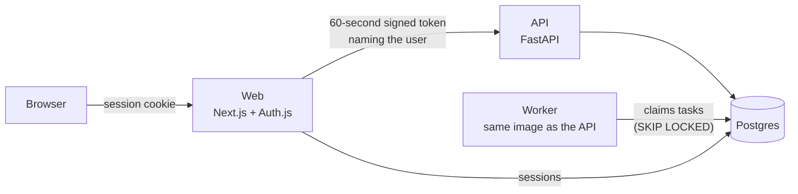

# Job Hunter

[](https://github.com/RichardHuang24/job-hunter/actions/workflows/ci.yml)
[](LICENSE)

Find, rank and track jobs, and build a tailored CV for each one - for any
industry, not just tech. Self-hosted, multi-user, open source.

> **Status: early development.** Accounts, profiles with industry presets,
> onboarding, the API and the background worker are in place. Job search,
> ranking, the applications tracker and the CV workbench arrive next; see the
> [roadmap](docs/roadmap.md).

## What works today

- **Sign-in** by emailed link, or with GitHub or Google if you configure them (Auth.js).
- **Onboarding in four steps**: pick an industry and job market, the roles
  you're after, where and how you'll work, and a little about you.
- **Presets for twelve industries and seven job markets** - from nursing and
  teaching to software and finance - as plain data files anyone can extend
  ([`presets/`](presets/README.md)).
- **A full profile**: levels, skills, languages, locations, work arrangements,
  work permits and minimum salary, editable any time.
- **Job-title rules** that tell which of your target roles a title is and how
  senior it is - try any title under Settings → Check a job title.
- **One API** that every feature goes through, scoped to the signed-in user.
- **A background worker** on a Postgres-backed queue - no Redis to run.
- **One command to run it all** with Docker Compose, and a production setup with
  automatic HTTPS for a single VPS.

## Quick start

You need [Docker](https://docs.docker.com/get-docker/) with Compose 2.24 or newer.

```sh
git clone https://github.com/RichardHuang24/job-hunter.git
cd job-hunter
./scripts/setup-env.sh          # creates .env with fresh secrets
docker compose up --build
```

Then open <http://localhost:3420>, sign in with any email address, and open
Mailpit at <http://localhost:8025> - it catches the sign-in email locally, so
nothing is really sent.

To check a running stack end to end: `python3 scripts/smoke_test.py`.

## How it fits together



The browser only ever talks to the web app. The web app checks the session and
forwards API calls with a short-lived token naming the user; the API accepts
nothing else. More in [docs/architecture.md](docs/architecture.md).

| Folder | What's in it |
| --- | --- |
| [`apps/web`](apps/web) | Next.js 16 app: pages, sign-in, the `/api/backend` door to the API |
| [`apps/api`](apps/api) | FastAPI service, SQLAlchemy models, Alembic migrations, the worker |
| [`presets`](presets) | Industries and job markets, as data files |
| [`deploy`](deploy) | Dockerfiles, the production Compose file, Caddy |
| [`scripts`](scripts) | `.env` setup, the end-to-end smoke test, the personal-data check |
| [`docs`](docs) | Architecture, roadmap, self-hosting, third-party notices |

## Running it on a server

[docs/self-hosting.md](docs/self-hosting.md) covers a single VPS: DNS, `.env`,
HTTPS with Caddy, updates and backups.

## Contributing

Bug reports and pull requests are welcome - start with
[CONTRIBUTING.md](CONTRIBUTING.md), which covers running the apps without
Docker, the tests, and the hooks that keep personal data out of the repo.
Security issues: see [SECURITY.md](SECURITY.md).

## License

[GNU Affero General Public License v3.0](LICENSE). If you run a modified
version for other people over a network, you must offer them its source code.

Job Hunter includes work from [ai-job-search](https://github.com/MadsLorentzen/ai-job-search)
by Mads Lorentzen, under the MIT License - see [NOTICE](NOTICE) and
[LICENSES/](LICENSES). It is not affiliated with any job board or employer.
