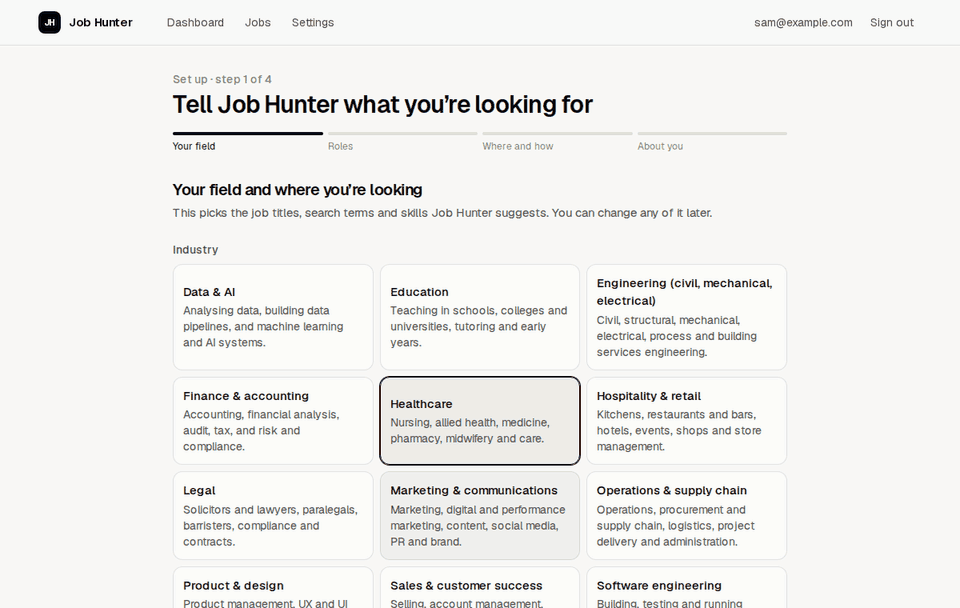
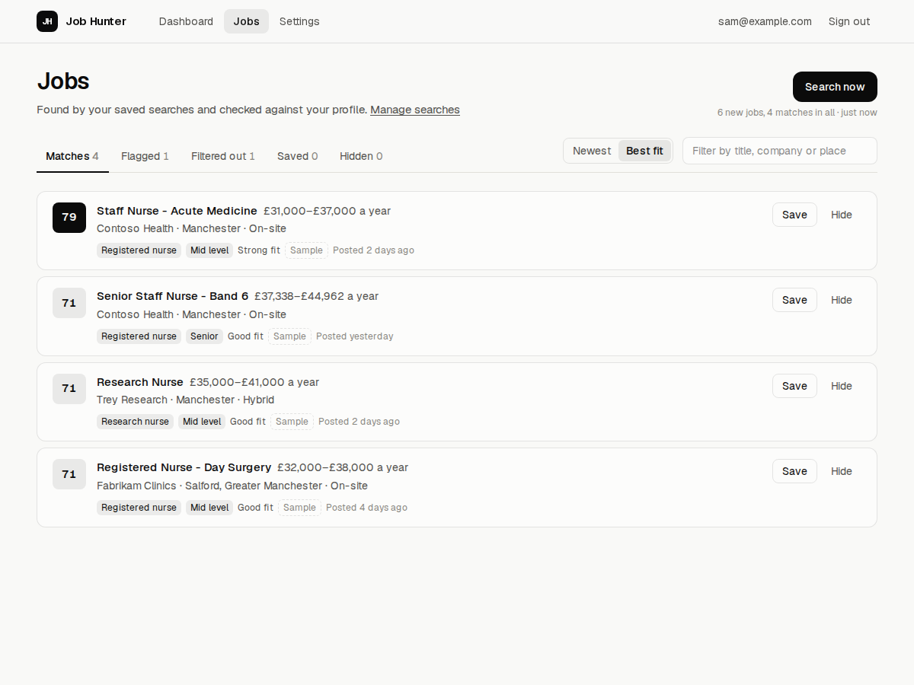
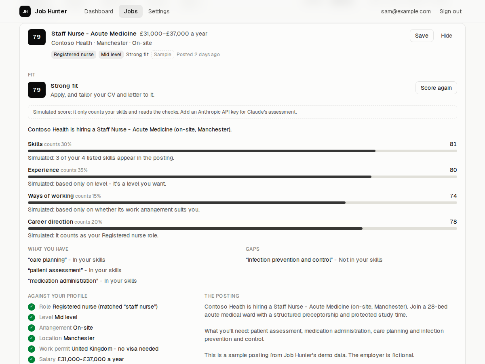
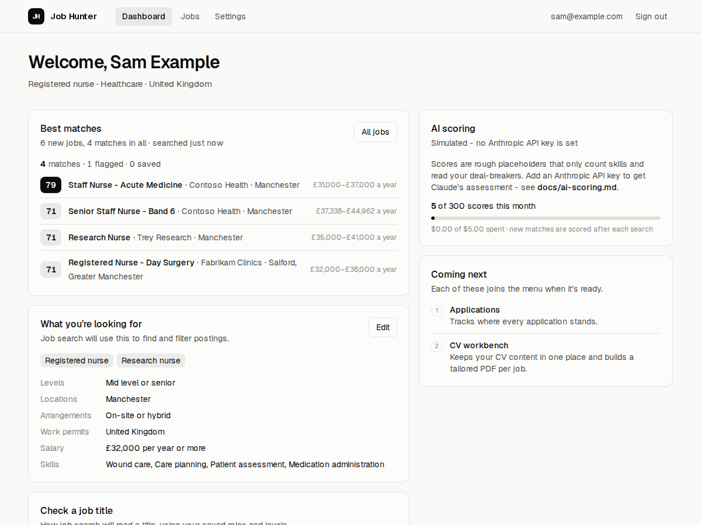
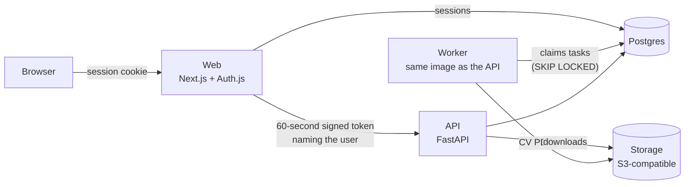

# Job Hunter

[](https://github.com/RichardHuang24/job-hunter/actions/workflows/ci.yml)
[](LICENSE)

Find, rank and track jobs, and build a tailored CV for each one - for any
industry, not just tech. Self-hosted, multi-user, open source.

> **Status: early development.** Accounts, onboarding, profiles with
> industry presets, job search with deal-breaker checks, AI fit scoring,
> application tracking and CV PDFs work today. Real jobs come from two free
> remote-job boards, Himalayas and Jobicy; job boards for on-site work and
> tailored CVs come next - see the [roadmap](docs/roadmap.md).



<sub>Built-in sample jobs with fictional employers, scored by the free simulated scorer. With an Anthropic API key, Claude writes the scores and the reasons. More [screenshots](#screenshots) below.</sub>

## What works today

- **Sign-in** by emailed link, or with GitHub or Google if you configure them (Auth.js).
- **Onboarding in four steps**: pick an industry and job market, the roles
  you're after, where and how you'll work, and a little about you.
- **Presets for twelve industries and seven job markets** - from nursing and
  teaching to software and finance - as plain data files anyone can extend
  ([`presets/`](presets/README.md)).
- **A full profile**: levels, skills, languages, locations, work arrangements,
  work permits and minimum salary, editable any time.
- **Job-title rules** that tell which of your target roles a title is and how
  senior it is - try any title under Settings → Check a job title.
- **Job search**: saved searches made from your profile, run daily in the
  background or on demand. Every job is checked against your deal-breakers -
  role, level, arrangement, location, work permit, salary - and filed under
  Matches, Flagged or Filtered out, with the reasons. Save or hide as you go.
- **AI fit scores**: each match scored 0-100 by Claude, with a reason per
  dimension, requirements quoted from the posting (and checked to be there),
  gaps and risks; best fit first. Without an Anthropic API key a free,
  clearly labelled simulated scorer stands in ([docs/ai-scoring.md](docs/ai-scoring.md)).
- **Applications**: track each job from "to apply" to an answer, with the
  next step and when, notes, and a history of every status - from a job
  here or added by hand - and export them all as CSV.
- **Your CV as plain facts, and a PDF of it on demand**: started from your
  profile, edited on the CV page, built with LuaLaTeX on the worker - with
  every character you type escaped, so nothing in a CV can run as code
  ([docs/cv.md](docs/cv.md)).
- **Real remote jobs** from [Himalayas](https://himalayas.app) and
  [Jobicy](https://jobicy.com) - free, used within their terms, credited on
  every job, and taken down when they close. Remote jobs carry the countries
  they're open to, so the work-permit check knows who can apply.
- **Pluggable job sources**, each declaring its countries and whether its
  terms allow commercial use ([docs/job-sources.md](docs/job-sources.md)).
  Built-in sample jobs (`JOB_SOURCES=demo`) work with no network at all.
- **One API** that every feature goes through, scoped to the signed-in user.
- **A background worker** on a Postgres-backed queue - no Redis to run.
- **Files in S3-compatible storage**: a small gateway in the stack keeps them
  as plain files; point it at Cloudflare R2 or AWS S3 instead with a few
  settings.
- **One command to run it all** with Docker Compose - no keys needed, every
  service health-checked, on Intel/AMD and ARM - and a production setup with
  automatic HTTPS for a single VPS.
- **Privacy built in**: a public privacy page stating what this server does
  with people's data, a one-click ZIP of everything kept about you, and
  account deletion that removes it all ([docs/privacy.md](docs/privacy.md)).
- **Billing groundwork**, off by default: a switch and Stripe's signed
  webhook, for the hosted version ([docs/billing.md](docs/billing.md)).

## Screenshots

**Matches, best fit first** - each checked against your deal-breakers and scored 0-100.

<picture>
  <source media="(prefers-color-scheme: dark)" srcset="docs/images/jobs-dark.png">
  
</picture>

**Why a job fits** - a reason for each part of the score, requirements quoted from the posting, gaps, and every deal-breaker check.

<picture>
  <source media="(prefers-color-scheme: dark)" srcset="docs/images/job-fit-dark.png">
  
</picture>

**The dashboard** - best matches, what you're looking for, and this month's AI scoring.

<picture>
  <source media="(prefers-color-scheme: dark)" srcset="docs/images/dashboard-dark.png">
  
</picture>

The walkthrough and screenshots are made by [`scripts/readme_media.py`](scripts/readme_media.py)
against a local stack with the sample jobs - run it again after changing the UI.

## Quick start

You need [Docker](https://docs.docker.com/get-docker/) with Compose 2.24 or newer.

```sh
git clone https://github.com/RichardHuang24/job-hunter.git
cd job-hunter
./scripts/setup-env.sh          # creates .env with fresh secrets
docker compose up --build
```

Then open <http://localhost:3420>, sign in with any email address, and open
Mailpit at <http://localhost:8025> - it catches the sign-in email locally, so
nothing is really sent. After the four-step setup, your first search runs
against Himalayas and Jobicy (remote jobs). To try it with the built-in
sample jobs instead, set `JOB_SOURCES=demo` in `.env`.

To check a running stack end to end, with `JOB_SOURCES=demo`: `python3 scripts/smoke_test.py`
over HTTP, and `python3 scripts/browser_test.py` in a real browser. CI does both on
every push, on Intel/AMD and ARM.

## How it fits together



The browser only ever talks to the web app. The web app checks the session and
forwards API calls with a short-lived token naming the user; the API accepts
nothing else. More in [docs/architecture.md](docs/architecture.md).

| Folder | What's in it |
| --- | --- |
| [`apps/web`](apps/web) | Next.js 16 app: pages, sign-in, the `/api/backend` door to the API |
| [`apps/api`](apps/api) | FastAPI service, SQLAlchemy models, Alembic migrations, the worker |
| [`presets`](presets) | Industries and job markets, as data files |
| [`deploy`](deploy) | Dockerfiles, the production Compose file, Caddy |
| [`scripts`](scripts) | `.env` setup, the end-to-end smoke and browser tests, the personal-data check, the README pictures |
| [`docs`](docs) | Architecture, roadmap, self-hosting, third-party notices |

## Running it on a server

[docs/self-hosting.md](docs/self-hosting.md) covers a single VPS: DNS, `.env`,
HTTPS with Caddy, updates and backups.

## Contributing

Bug reports and pull requests are welcome - start with
[CONTRIBUTING.md](CONTRIBUTING.md), which covers running the apps without
Docker, the tests, and the hooks that keep personal data out of the repo.
Security issues: see [SECURITY.md](SECURITY.md).

## License

[GNU Affero General Public License v3.0](LICENSE). If you run a modified
version for other people over a network, you must offer them its source code.

Job Hunter includes work from [ai-job-search](https://github.com/MadsLorentzen/ai-job-search)
by Mads Lorentzen, under the MIT License - see [NOTICE](NOTICE) and
[LICENSES/](LICENSES). It is not affiliated with any job board or employer.
