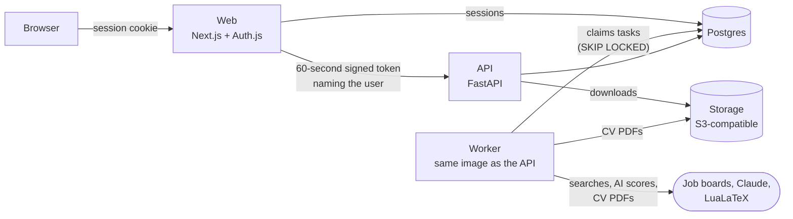

# Job Hunter

[](https://github.com/RichardHuang24/job-hunter/actions/workflows/ci.yml)
[](LICENSE)


**Find, rank and track jobs, and keep your CV ready - for any industry, not
just tech.** Job Hunter searches job boards for the roles you want, checks
every posting against your deal-breakers, scores how well each one fits you
with AI, tracks your applications, and turns your CV into a clean PDF.
Self-hosted, multi-user and open source.


<sub>Built-in sample jobs with fictional employers, scored by the free simulated scorer. With an Anthropic API key, Claude writes the scores and the reasons.</sub>

> **Status: early development.** Everything below works and is tested on
> every push. Real jobs come from two free remote-job boards today; boards
> for on-site work in each country, tailored CVs and a hosted version come
> next ([roadmap](docs/roadmap.md)).

## Contents

[Try it](#try-it) · [Features](#features) · [Screenshots](#screenshots) ·
[Cloud or self-hosted](#cloud-or-self-hosted) · [Quick start](#quick-start) ·
[Configuration](#configuration) · [Job sources](#job-sources-and-their-terms) ·
[How it works](#how-it-works) · [Development](#development) ·
[Documentation](#documentation) · [Roadmap](#roadmap) ·
[Contributing](#contributing) · [Security](#security) ·
[License](#license-and-acknowledgements)

## Try it

The quickest way to see everything is **demo mode**: one command, then pick
a fictional person to be - a nurse, a data analyst or a software engineer -
and you arrive with jobs found and scored, applications in progress and a
CV, no sign-up needed.

```sh
git clone https://github.com/RichardHuang24/job-hunter.git && cd job-hunter
./scripts/setup-env.sh
DEMO_MODE=true JOB_SOURCES=demo docker compose up --build
```

Open <http://localhost:3420> and choose someone. Everything you see is made
up, and each demo account is deleted after a day. To run a public demo site
for others, see [docs/demo.md](docs/demo.md).

## Features

**Know what you're after**
- Set up in four steps: your field and job market, the roles you want, where
  and how you'll work, and a little about you.
- Presets for twelve industries - nursing, teaching, software, finance,
  hospitality and more - and seven markets (UK, Ireland, US, Canada, EU,
  Australia, remote), as plain data files anyone can extend
  ([presets/](presets/README.md)).
- Your deal-breakers: levels, places, on-site/hybrid/remote, where you can
  work without a visa, minimum salary.

**Find jobs**
- Saved searches, made from your profile, run every day in the background or
  whenever you press **Search now**.
- Real remote jobs from [Himalayas](https://himalayas.app) and
  [Jobicy](https://jobicy.com), used within their terms and taken down when
  they close; built-in sample jobs work with no network at all.
- The same job on two boards is shown once.

**See which ones fit**
- Every job is checked against your deal-breakers - role, level,
  arrangement, place, work permit, salary - and filed under Matches,
  Flagged or Filtered out, with the reason for each.
- An AI fit score from 0 to 100, with a reason for skills, experience, ways
  of working and career direction; requirements quoted from the posting
  (and checked to really be there); gaps and risks. Claude does it with an
  API key - under a tenth of a cent a job - and a free simulated scorer
  stands in without one ([docs/ai-scoring.md](docs/ai-scoring.md)).

**Track your applications**
- Track a job with one click ("I've applied"), or add one found elsewhere.
- Move each from *To apply* to *Applied*, *Interviewing*, *Offer* - or a
  rejection - with the date, the next step and when, notes, and a history of
  every status.
- Next steps on the dashboard; export everything as CSV.

**Keep your CV ready**
- Your CV as plain facts - started from your profile, edited on the CV page.
- A clean PDF whenever you want one, built with LuaLaTeX; everything you
  type is escaped, so nothing in a CV can run as code ([docs/cv.md](docs/cv.md)).

**Your data stays yours**
- A public privacy page that says what this server does with people's data.
- Download everything kept about you as a ZIP; delete your account and all
  of it with one confirmation ([docs/privacy.md](docs/privacy.md)).

**Easy to run**
- One `docker compose up`: no API keys needed, every service health-checked,
  on Intel/AMD and ARM; a production setup with automatic HTTPS for one VPS.
- An admin page - people, AI costs per person, job sources' error rates, the
  task queue - JSON logs, and optional error reports to Sentry
  ([docs/admin.md](docs/admin.md)).

## Screenshots

**Matches, best fit first** - each checked against your deal-breakers and scored 0-100.

<picture>
  <source media="(prefers-color-scheme: dark)" srcset="docs/images/jobs-dark.png">
  
</picture>

**Why a job fits** - a reason for each part of the score, requirements quoted from the posting, gaps, and every deal-breaker check.

<picture>
  <source media="(prefers-color-scheme: dark)" srcset="docs/images/job-fit-dark.png">
  
</picture>

**The dashboard** - best matches, what you're looking for, and this month's AI scoring.

<picture>
  <source media="(prefers-color-scheme: dark)" srcset="docs/images/dashboard-dark.png">
  
</picture>

The walkthrough and screenshots are made by [`scripts/readme_media.py`](scripts/readme_media.py)
against a local stack with the sample jobs - run it again after changing the UI.

## Cloud or self-hosted

| | Self-hosted | Cloud |
| --- | --- | --- |
| Available | Now | Planned ([roadmap](docs/roadmap.md)) |
| Price | Free (AGPL-3.0) | Subscription |
| Runs on | Your computer or server, with Docker | Ours - sign up and go |
| AI scoring | Free simulated scorer, or your own Anthropic API key | Included, within your plan |
| Job sources | Any you enable, including ones that need your own key | Those whose terms allow a paid service |
| Your data | On your server | On ours; export or delete it any time |

## Quick start

You need [Docker](https://docs.docker.com/get-docker/) with Compose 2.24 or
newer, and about 2 GB of memory.

```sh
git clone https://github.com/RichardHuang24/job-hunter.git
cd job-hunter
./scripts/setup-env.sh          # creates .env with fresh secrets
docker compose up --build
```

1. Open <http://localhost:3420> and sign in with any email address.
2. Open Mailpit at <http://localhost:8025> - it catches the sign-in email, so
   nothing is really sent - and click the link.
3. Go through the four-step setup. Your first search runs straight away,
   against Himalayas and Jobicy (remote jobs); set `JOB_SOURCES=demo` in
   `.env` for the built-in sample jobs instead.

| Service | Address |
| --- | --- |
| Job Hunter | <http://localhost:3420> |
| Mailpit (development email) | <http://localhost:8025> |
| API and its OpenAPI docs | <http://localhost:8420/docs> |

To put it on a server with HTTPS, see [docs/self-hosting.md](docs/self-hosting.md).
After pulling a new version, run `./scripts/setup-env.sh` again - it adds any
new secrets and changes nothing else - then `docker compose up --build`.

## Configuration

Everything is set in `.env` ([`.env.example`](.env.example) lists it all).
`scripts/setup-env.sh` fills in the secrets - `AUTH_SECRET`,
`BACKEND_JWT_SECRET`, `POSTGRES_PASSWORD`, `STORAGE_ACCESS_KEY`,
`STORAGE_SECRET_KEY` - and the rest have working defaults.

| Setting | Default | What it does |
| --- | --- | --- |
| `DOMAIN` | | Your domain, for production with HTTPS |
| `EMAIL_SERVER`, `EMAIL_FROM` | Mailpit | The SMTP server for sign-in links |
| `AUTH_GITHUB_ID`, `AUTH_GITHUB_SECRET`, `AUTH_GOOGLE_ID`, `AUTH_GOOGLE_SECRET` | | Optional "Continue with GitHub / Google" |
| `JOB_SOURCES` | `himalayas,jobicy` | Job sources to search: `himalayas`, `jobicy`, `demo` ([docs](docs/job-sources.md)) |
| `HIMALAYAS_API_KEY` | | Optional; raises Himalayas' rate limits |
| `COMMERCIAL_ONLY` | `false` | Leave out sources whose terms don't allow a paid service |
| `ANTHROPIC_API_KEY` | | Claude for fit scores; empty: the free simulated scorer ([docs](docs/ai-scoring.md)) |
| `AI_MODEL`, `AI_EFFORT` | `claude-haiku-5-5`, `low` | Which Claude model, and how hard it works |
| `AI_SCORES_PER_MONTH`, `AI_BUDGET_USD_PER_MONTH` | `300`, `5` | Each person's monthly AI allowance |
| `S3_ENDPOINT_URL`, `S3_REGION`, `S3_BUCKET`, `S3_ACCESS_KEY_ID`, `S3_SECRET_ACCESS_KEY` | the built-in store | Keep CV PDFs in Cloudflare R2 or AWS S3 instead ([docs](docs/self-hosting.md#files)) |
| `ADMIN_EMAILS` | | Who can open the admin page ([docs](docs/admin.md)) |
| `SENTRY_DSN` | | Send errors to Sentry or GlitchTip; empty: off |
| `LOG_FORMAT` | `json` | `text` to read logs in a terminal |
| `PRIVACY_CONTROLLER`, `PRIVACY_CONTACT` | | Who runs this site and how to reach them, for the privacy page ([docs](docs/privacy.md)) |
| `SOURCE_URL` | this repository | Where people can get this copy's source code |
| `DEMO_MODE`, `DEMO_ACCOUNT_HOURS` | `false`, `24` | Run as a public demo site ([docs](docs/demo.md)) |
| `BILLING_ENABLED`, `STRIPE_SECRET_KEY`, `STRIPE_WEBHOOK_SECRET` | `false` | Billing with Stripe; off: everything is free ([docs](docs/billing.md)) |

## Job sources and their terms

Job Hunter only uses sources whose terms allow it, credits each one on
every job, and follows their rules - details and the terms themselves are in
[docs/job-sources.md](docs/job-sources.md) and [docs/third-party.md](docs/third-party.md).

| Source | Jobs | Cost | Paid use allowed | How it's used |
| --- | --- | --- | --- | --- |
| Sample jobs (`demo`) | 78 fictional postings across industries | Free | Yes - our own | For trying it out, demos and tests |
| [Himalayas](https://himalayas.app/api) | Remote jobs worldwide | Free; key optional | Yes | Searched per term and country, kept 6 hours; checked daily for closed jobs |
| [Jobicy](https://jobicy.com/jobs-rss-feed) | Remote jobs from the last 7 days | Free | Yes | Whole feed read at most hourly; closed jobs checked every 6 hours |

LinkedIn and Indeed aren't used: their terms don't allow it. Boards for
on-site work in each country are next, each added once its terms are
checked ([how to add one](docs/job-sources.md#adding-one)).

## How it works



The browser only ever talks to the web app. The web app checks the session
and forwards API calls with a short-lived token naming the user; the API
accepts nothing else, and every query is scoped to that user. Slow work -
searches, AI scores, PDFs - runs on the worker from a queue in Postgres, so
there's no Redis to run. More in [docs/architecture.md](docs/architecture.md).

| Folder | What's in it |
| --- | --- |
| [`apps/web`](apps/web) | Next.js 16 app: pages, sign-in, the `/api/backend` door to the API |
| [`apps/api`](apps/api) | FastAPI service, SQLAlchemy models, Alembic migrations, the worker |
| [`presets`](presets) | Industries and job markets, as data files |
| [`deploy`](deploy) | Dockerfiles, the production Compose file, Caddy |
| [`scripts`](scripts) | `.env` setup, the smoke and browser tests, the personal-data check, the README pictures |
| [`docs`](docs) | Everything else - see [Documentation](#documentation) |

## Development

Run the database in Docker and the app you're working on directly, with
hot reload - [CONTRIBUTING.md](CONTRIBUTING.md) has the steps. The tests:

```sh
cd apps/api && .venv/bin/pytest                                # API: SQLite, or Postgres with TEST_DATABASE_URL
cd apps/web && npm run lint && npm run typecheck && npm test   # web
python3 scripts/smoke_test.py                                  # a running stack, over HTTP (JOB_SOURCES=demo)
python3 scripts/browser_test.py                                # the same in a real browser; --demo for demo mode
```

CI runs all of them on every push - the API on SQLite and Postgres, then the
whole Docker stack on Intel/AMD and ARM, over HTTP and in a browser, in
normal and demo mode - plus a secret scan of every commit and a check that
no personal data gets in.

## Documentation

| | |
| --- | --- |
| [Self-hosting](docs/self-hosting.md) | One VPS with HTTPS: install, files, backups, health, logs, updates |
| [Demo site](docs/demo.md) | Running a public demo with fictional people |
| [Job sources](docs/job-sources.md) | Each source, its terms, and adding one |
| [AI scoring](docs/ai-scoring.md) | How fit is scored, models and costs |
| [CVs and PDFs](docs/cv.md) | The CV, the PDF builder and its safety |
| [Privacy](docs/privacy.md) | People's rights, the privacy page, and what's left to you |
| [Admin, logs and errors](docs/admin.md) | The admin page, JSON logs, Sentry |
| [Billing](docs/billing.md) | The billing switch and Stripe's webhook |
| [Architecture](docs/architecture.md) | How the pieces fit together |
| [Third-party software and data](docs/third-party.md) | Licences, services and data terms |
| [Questions](docs/faq.md) | The common ones |

## Roadmap

Done: foundation, profiles and presets, job search, AI ranking, applications,
CVs and PDFs, privacy, admin and demo mode. Next: job boards for on-site
work in each country, a tailored CV for each job, then the hosted version
with plans and billing. The details: [docs/roadmap.md](docs/roadmap.md).

## Contributing

Bug reports, ideas and pull requests are welcome - start with
[CONTRIBUTING.md](CONTRIBUTING.md). Adding an industry or a job market is a
data file ([presets/README.md](presets/README.md)); adding a job board is
one Python file ([docs/job-sources.md](docs/job-sources.md#adding-one)).

## Security

Please report vulnerabilities privately, as [SECURITY.md](SECURITY.md)
describes - not in a public issue.

## License and acknowledgements

[GNU Affero General Public License v3.0](LICENSE). If you run a modified
version for other people over a network, you must offer them its source
code - the footer of every page links to it (`SOURCE_URL`).

Job Hunter grew out of [ai-job-search](https://github.com/MadsLorentzen/ai-job-search)
by Mads Lorentzen, under the MIT License - see [NOTICE](NOTICE) and
[LICENSES/](LICENSES). It's built on many open-source projects, listed with
their licences in [docs/third-party.md](docs/third-party.md).

Job Hunter is an independent project. It is not affiliated with, endorsed by
or sponsored by Anthropic, the job boards it uses, or any employer. Claude is
a trademark of Anthropic.
