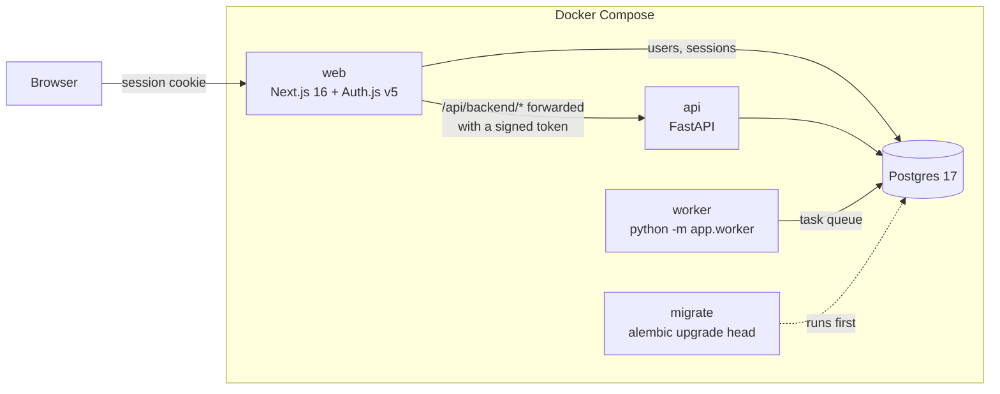

# Architecture

Job Hunter is two apps and a database, deployed as one Docker Compose stack.

## The pieces

| Service | What it does | Code |
| --- | --- | --- |
| `web` | Pages, sign-in, and the only door to the API | `apps/web` |
| `api` | Every feature's logic and data, per user | `apps/api/app` |
| `worker` | Runs searches (and later AI scoring and PDF builds) from the queue, and queues daily searches | `apps/api/app/worker.py` |
| `migrate` | Brings the schema up to date, then exits; the others wait for it | `apps/api/alembic` |
| `db` | Postgres: users, sessions, profiles, searches, jobs, tasks - everything | |
| `mailpit` | Development only: catches outgoing email | |
| `caddy` | Production only: HTTPS in front of `web` | `deploy/Caddyfile` |

## A request, end to end

1. The browser asks the web app for `/api/backend/me`.
2. `app/api/backend/[...path]/route.ts` checks the Auth.js session (stored in
   Postgres). No session: `401`.
3. It checks the path is plain segments only (`src/lib/backendPath.ts`), then
   signs a JWT - HS256, `sub` = the user's id, 60-second expiry - with
   `BACKEND_JWT_SECRET` (`src/lib/backend.ts`).
4. The API verifies the token's signature, issuer, audience and expiry
   (`app/auth.py`), loads the user, and runs the endpoint. Endpoints read and
   write only that user's rows.

Server components skip the hop and call the API directly with the same token
(`src/lib/session.ts`). The API is never exposed outside the stack.

## Sign-in

Auth.js v5 with database sessions (`@auth/pg-adapter`). Providers switch on
from the environment: an emailed link when `EMAIL_SERVER` is set, GitHub and
Google when their client id and secret are. `src/proxy.ts` (Next.js 16's
name for middleware) sends signed-out visitors to `/signin`.

Alembic owns every table, including the four Auth.js ones (`users`,
`accounts`, `sessions`, `verification_token`), so one migration history
describes the whole database.

## Background work

`app/tasks/queue.py` is a queue on Postgres. A worker claims the oldest due
task with `SELECT ... FOR UPDATE SKIP LOCKED`, so several workers never take
the same task. A task whose worker died is claimed again once its lease
(`TASK_LEASE_SECONDS`, 10 minutes) runs out. Failures retry after 30 s, 2 min,
8 min..., until the task's attempts are used up.

Handlers register by kind in `app/tasks/handlers.py`. `python -m app.worker
--check` queues a `ping` and waits for an answer - a quick way to see that a
worker is running.

## Profiles, presets and job titles

Industries and markets live in [`presets/`](../presets/README.md) as TOML
files, loaded and cross-checked once by `app/presets` (`GET /presets`,
`/presets/industries/{key}`, `/presets/markets/{key}`). Each industry brings
its roles (the job titles each covers and the terms to search for), suggested
skills, scoring weights and seniority words, so supporting a new field is a
new file, not code.

A profile (`profiles`) holds the person's industry and market, the levels
they want, skills and languages, and the deal-breakers: locations, work
arrangements, the countries they can work in without a visa, and a minimum
salary. Their **target roles** (`profile_targets`) start from the industry's
preset roles in onboarding (`POST /me/onboarding`) and can be edited freely
(`PUT /me/targets`).

`app/matching/titles.py` reads a job title against those target roles: which
role it is (the longest matching phrase wins; exclusions knock a role out)
and how senior it is. `POST /me/title-check` runs it for one title, so people
can see how job search will read a posting before job search exists.

## Job search

A **saved search** (`saved_searches`) holds terms, places and countries.
Running one creates a `search_runs` row and queues a `search` task; the
worker does the work (`app/search/runs.py`):

1. The search becomes queries - every term in every place
   (`app/search/queries.py`).
2. Each enabled **job source** (`app/sources/`, see
   [job-sources.md](job-sources.md)) that covers the query's countries is
   asked. A source that fails is recorded on the run; the others carry on.
3. Postings go into the shared **`jobs`** table - one row per source and
   source id, updated on every sighting. A fingerprint of company, title and
   place stops the same job from two sources showing twice.
4. Each job the user hasn't seen gets a **`user_jobs`** row: which of their
   roles it is, its level, and the deal-breaker checks
   (`app/matching/evaluate.py`) - role, level, arrangement, location, work
   permit, salary - each pass, flag, fail or unknown, with the reason. Any
   fail files the job under "Filtered out"; any flag under "Flagged".

Changing the profile or the target roles re-judges every job the user has.
Daily searches are queued by the worker itself (`app/search/schedule.py`,
with `SKIP LOCKED` so several workers never queue the same search twice).

## Where the rest goes

See [roadmap.md](roadmap.md). AI scoring, the applications tracker, the CV
workbench and billing all follow the same rules: data scoped to the user,
slow work on the worker, every call through the API.
